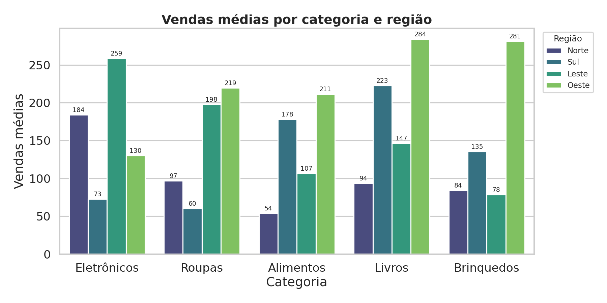
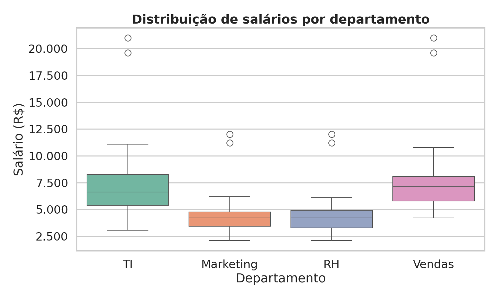
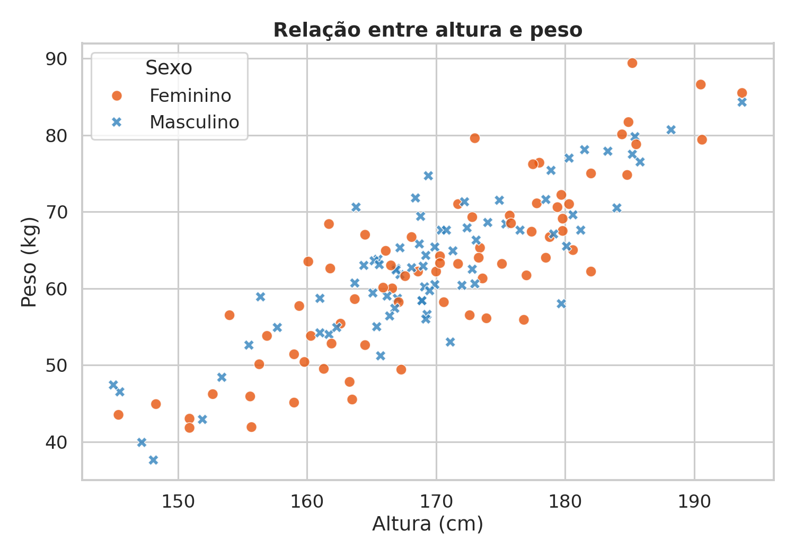
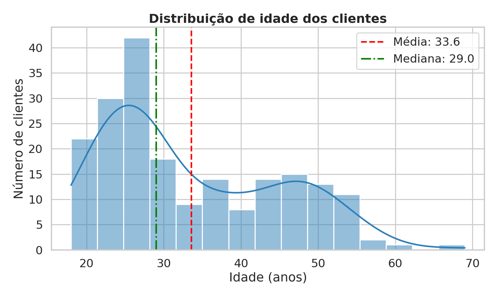
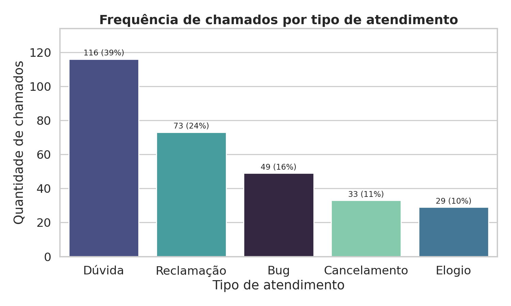
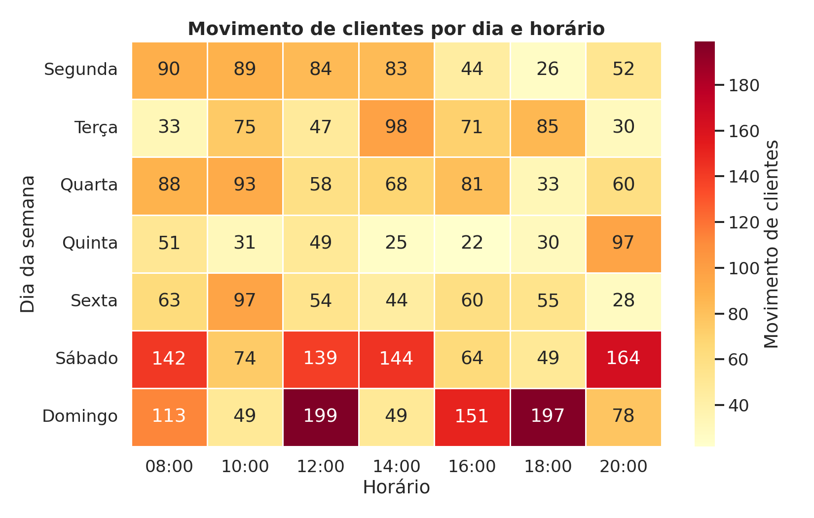
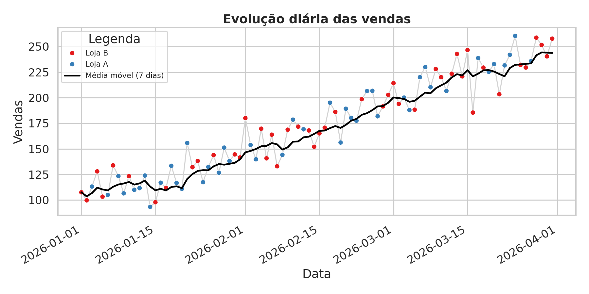
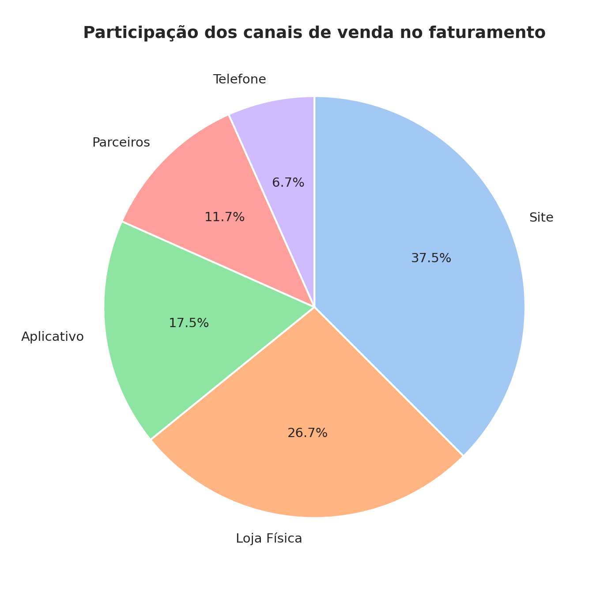
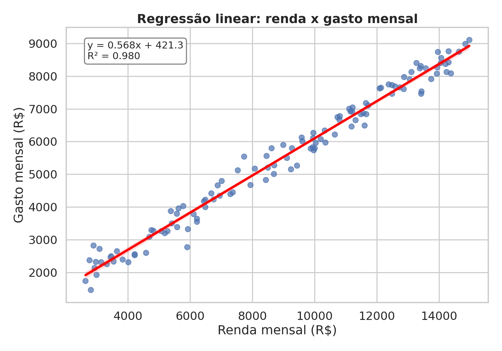

# Atividade de Fixação 06 – Gráficos

Um script Python para cada gráfico, usando `pandas`, `matplotlib`, `seaborn` e `scipy`.

| # | Script | Dados | Gráfico |
|---|--------|-------|---------|
| 1 | `scripts/01_barras.py` | `dados_barras.csv` | Barras agrupadas (categoria x região) |
| 2 | `scripts/02_boxplot.py` | `dados_boxplot.csv` | Boxplot de salários por departamento |
| 3 | `scripts/03_dispersao.py` | `dados_dispersao.csv` | Dispersão altura x peso (por sexo) |
| 4 | `scripts/04_distribuicao.py` | `dados_distribuicao.csv` | Histograma + densidade das idades |
| 5 | `scripts/05_frequencia.py` | `dados_frequencia.csv` | Frequência de tipos de atendimento |
| 6 | `scripts/06_heatmap.py` | `dados_heatmap.csv` | Mapa de calor dia x horário |
| 7 | `scripts/07_linhas.py` | `dados_linhas.csv` | Linha temporal de vendas + média móvel |
| 8 | `scripts/08_pizza.py` | `dados_pizza.csv` | Pizza de faturamento por canal |
| 9 | `scripts/09_regressao.py` | `dados_regressao.csv` | Regressão linear renda x gasto |

## Como executar

```bash
pip install -r requirements.txt
python scripts/01_barras.py     # repita para os demais
```

Cada script lê o CSV da pasta `dados/`, salva a imagem em `imagens/` e abre a janela do gráfico.
Os caminhos são relativos ao script, então pode rodar de qualquer pasta.

## Resultados










